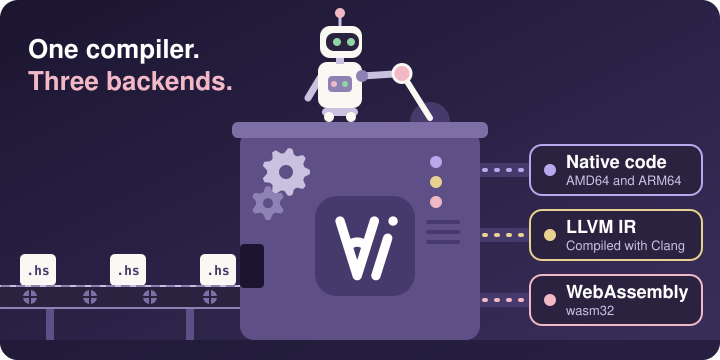

<p align="center">
  <a href="https://aihc.app/">
    
  </a>
</p>

<p align="center">
  <a href="https://aihc.app/"><b>Website</b></a> ·
  <a href="https://docs.aihc.app/"><b>Manual</b></a> ·
  <a href="https://lazy.aihc.app/"><b>Try it in the browser</b></a> ·
  <a href="https://perf.aihc.app/"><b>Benchmarks</b></a> ·
  <a href="https://blog.aihc.app/"><b>Journal</b></a> ·
  <a href="https://discord.gg/uGWkhMCZrZ"><b>Discord</b></a>
</p>

<p align="center">
  <a href="https://github.com/ai-haskell-compiler/aihc/releases/latest"></a>
  <a href="https://discord.gg/uGWkhMCZrZ"></a>
  <a href="LICENSE"></a>
</p>

AIHC is a new Haskell compiler that AI models wrote.
It builds real Hackage packages.
It builds them quickly, and it makes small executables.

<p align="center">
  
</p>

## Why AIHC

- **Fast builds.** AIHC compiles the modules of a package in parallel by default.
- **Small binaries.** AIHC optimizes the whole program and removes the code that the program does not use.
- **Real Haskell.** AIHC accepts GHC language extensions. It builds Hackage packages such as `aeson`, `text`, `containers`, and `vector`.
- **Self-hosting.** AIHC compiles itself. The compiler that AIHC builds makes an identical copy of itself.
- **Its own runtime.** The runtime has a generational garbage collector with short pauses, green threads, and STM.
- **Three backends.** One compiler makes native machine code, LLVM IR, and WebAssembly.

<p align="center">
  
</p>

The benchmark site compares AIHC with GHC on each commit.
See [perf.aihc.app](https://perf.aihc.app/) for the build times, the executable sizes, and the run times.

## Install

**macOS on Apple silicon**

```bash
curl -L https://github.com/ai-haskell-compiler/aihc/releases/download/v0.2.1/aihc-0.2.1-apple-arm64.tar.gz | tar -xz
sudo install aihc-0.2.1-apple-arm64/aihc /usr/local/bin/aihc
```

**Linux on AMD64**

```bash
curl -L https://github.com/ai-haskell-compiler/aihc/releases/download/v0.2.1/aihc-0.2.1-linux-amd64.tar.gz | tar -xz
sudo install aihc-0.2.1-linux-amd64/aihc /usr/local/bin/aihc
```

**Fedora**

```bash
sudo dnf copr enable petersen/aihc
sudo dnf install aihc
```

**From source**

This procedure needs [Nix](https://nixos.org/download/) with flakes.

```bash
git clone https://github.com/ai-haskell-compiler/aihc.git
cd aihc
nix develop
cabal build exe:aihc
```

All releases are on the [releases page](https://github.com/ai-haskell-compiler/aihc/releases).

## Your first program

Write `Main.hs`:

```haskell
main :: IO ()
main = putStrLn "Hello from AIHC"
```

Build the program and run it:

```bash
aihc build Main.hs --output hello
./hello
```

The first build installs the core libraries.
This step takes some minutes.
The subsequent builds are fast.

AIHC also builds Cabal packages, and it gets packages from Hackage.
The [manual](https://docs.aihc.app/users/getting-started/) gives the instructions.

## Status

AIHC is under construction.
The `base` library is not complete, and some programs that GHC accepts do not compile.
If your program does not compile, tell us on [Discord](https://discord.gg/uGWkhMCZrZ) or open an [issue](https://github.com/ai-haskell-compiler/aihc/issues).

## Learn more

| Site | Contents |
| --- | --- |
| [aihc.app](https://aihc.app/) | An overview of the compiler, with examples |
| [docs.aihc.app](https://docs.aihc.app/) | The user guide and the developer manual |
| [lazy.aihc.app](https://lazy.aihc.app/) | The Lazy Reader, an illustrated guide that runs the compiler in your browser |
| [perf.aihc.app](https://perf.aihc.app/) | Benchmark results for each commit, compared with GHC |
| [hackage.aihc.app](https://hackage.aihc.app/) | The Hackage packages that AIHC builds |
| [blog.aihc.app](https://blog.aihc.app/) | The journal, with progress reports and technical articles |

## Contribute

AI models wrote the compiler.
Humans write the prompts and review the results.
Pull requests from everyone are welcome.
See [CONTRIBUTING.md](CONTRIBUTING.md) for the procedure.

## License

AIHC is in the public domain.
See [LICENSE](LICENSE).
